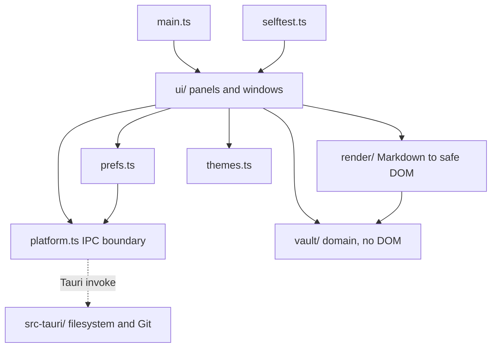

# Architecture

Waymark has a TypeScript frontend running in WKWebView and a Rust layer that owns the filesystem and Git. Layers below may not import layers above them, and `pnpm arch` enforces it.

## Lifetimes

Two objects own almost all state, and their lifetimes differ.

- `App` (`src/ui/app.ts`) lives as long as the process. It owns preferences, the theme, the syntax highlighter and which vault is open.
- `Reader` (`src/ui/reader.ts`) lives as long as one open vault. It builds the window, owns the panels and the tabs, and decides what is on screen. Opening another vault disposes it and builds a new one, so no panel has to handle "no vault yet".

## Domain (`src/vault/`)

Pure TypeScript with no DOM, tested directly.

| Module | Owns |
|---|---|
| `store.ts` | One vault's note text and everything derived from it. The only place a change on disk is applied. |
| `index.ts` | Resolving a link target to a file. |
| `links.ts` | Outgoing links and backlinks. |
| `search.ts` | The full-text index and snippets. |
| `communities.ts` | Grouping notes by how they link. |
| `tree.ts` | Folder structure for the sidebar. |
| `trail.ts` | One tab's map of where it has been. |
| `workspace.ts` | The open tabs. |
| `draft.ts` | The text being edited and what is on disk. |
| `tasks.ts` | Task lines: toggling, progress and line endings. |

## Opening a note

`Reader.open` moves the active tab's trail, then `Reader.show` draws whatever the trail now points at.

1. `show` takes a sequence number. If a newer navigation starts while this one awaits, the older one stops.
2. `VaultStore.read` returns the text.
3. `renderNote` turns Markdown into a sanitised fragment. `sanitize.ts` is the trust boundary for note content.
4. `NoteView` mounts it, then the tab strip, trail, tree and inspector update.
5. Diagrams render last, so a slow Mermaid block never delays the text.

## Changing a note

`NoteEditing` (`src/ui/note-editing.ts`) owns every change to a note: clicking a task and editing one note at a time. A `Draft` (`src/vault/draft.ts`) holds the text and the version known to be on disk, saves one write at a time, and stops when the file changed elsewhere. `VaultStore.save` writes through `write_note` and updates the indexes once the disk has the text.

`live-preview.ts` only decorates. It hides and styles syntax but never changes the document, so the file on disk stays exactly what was typed. CodeMirror is imported on first edit and stays out of the startup bundle.

`GitPanel.commitAndSync` saves the draft, fetches, fast-forwards, commits and pushes in that order, so nothing is committed on top of a stale branch.

## Startup

The restored note appears after one file read. The rest of the vault is read and indexed afterwards, and the note is redrawn in place so links gain their targets. Nothing waits on the network.

## Input

`reader-commands.ts` is one table of commands. The palette lists it, the keyboard matches chords against it, and `data-act` buttons call into it. `reader-clicks.ts` is an ordered selector table for clicks on everything else, including links inside notes.

## Git and files (`src-tauri/`)

- `folders.rs` renames and trashes whole folders, and refuses the vault itself, dot-folders and symlinks.
- `vault.rs` is the path guard. Paths are checked as written and again after symlinks resolve. It also holds `write_note`, which only replaces text the caller expected and writes through a temporary file and a rename.
- `git/runner.rs` runs the system `git`. A process runs in one of three modes. `Read` and `Network` have time limits. `Write` is never killed, because stopping it midway can leave a half-updated checkout. After two minutes Waymark stops waiting and reports it, so a stuck hook cannot wedge the sync panel.
- `git/mod.rs` holds the operations. Each returns fresh status, so the UI cannot show a stale view after an action.
- `lib.rs` exposes the commands. Commands that change the repository take a write gate, so two writes never race for Git's index lock. It also runs the watcher and serves `vault://`.

`SyncController` (`src/ui/sync-controller.ts`) decides when to refresh and what the status bar says, and `GitPanel` is the drawer.

## Checks

| Layer | Proves | Run with |
|---|---|---|
| `tests/unit/` | Domain logic, renderer, sanitizer, command table | `pnpm test` |
| `cargo test` | Path guard, Git safety on throwaway repositories, redaction | `pnpm rust` |
| `tests/e2e/reader.mjs` | User-visible behaviour in WebKit | `pnpm test:e2e` |
| `tests/native/run.mjs` | The packaged app: IPC, `vault://`, real Git refusals | `pnpm test:native` |
